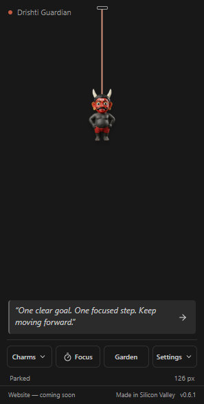
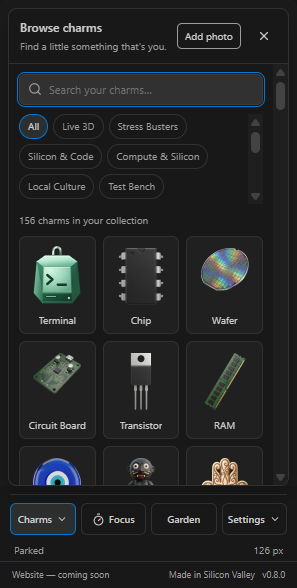

# Charmlet

**Charmlet: Coding Charms** is a small, interactive hanging charm in a dockable VS Code view.

**Music Icons trial candidate:** **0.12.0** includes **234 offline charms**: 209 rendered designs, Terminal, fifteen live companions and nine fidget/puzzle tools. Terminal leads the collection, followed by **Live 3D**, **Stress Busters**, **Music** and **Music Icons**. All 34 approved artist studies join the included trial: the original ten, twelve legends and twelve current performers. Previously imported artist packs retain their exact artwork and saved IDs without duplicate bundled tiles.

**Cali** keeps the approved grizzly face, seven outfits, saved wardrobe choice and four playful tap reactions. Four spinner designs turn under your pointer; Twisty Cube, Sliding Tiles and Lights Out have optional boards and saved progress. Every charm has a brief tap wiggle. The default 100% is 15% larger, and Appearance offers 60-200% sizing. Encouragement, pets, matched cords, small wins, local photos and the eighteen-flower garden carry forward. [Current verification and release gates](docs/phase-13-artists-website.md) distinguish this candidate from earlier checks.

Open **Charms** after installing the trial; separate imports are no longer required. The **Art review** compares **210 featured designs**, including the original Terminal and all eighteen flower illustrations. Flower previews do not unlock garden rewards or change watering progress. Existing imports, saved choices and previously shared pack files remain intact. Public distribution, future paid artwork, licences and signing remain release decisions. Creating local photo charms inside the app is free.

**Desktop 0.9.0 candidate:** starts with only the charm and cord. Hover for Move and Tools; open one control panel at a time, with optional background, toolbar and messages. Choose Cali for brief encouragement bubbles, or turn those off under Focus. Terminal, Live 3D, Stress Busters, Music and Music Icons lead the picker. Pulls use the available screen space. See the [desktop guide](desktop/README.md).

The refreshed website leads with a live Cali preview and a separate searchable gallery. A [Vercel setup guide](docs/vercel-hosting.md) covers the owner's `greensilver-personal` team. [Payments and future merchandise](docs/monetization-and-payments.md) compares Stripe, Square and Shopify, recommending hosted Shopify delivery when new paid packs are ready and physical products later. Prices are proposals; live sales are not enabled.

Holiday defaults follow **21 US celebration dates** and rotate Christmas designs through December. They are on for new profiles. An update preserves existing opt-outs and pins; use **Settings > Appearance > Follow holiday defaults** to enable and unpin in one click. Picking a charm pins it. Automatic choices use the local date and never replace the saved usual charm. [Phase 6 scope and verification](docs/phase-6-trial-catalogue.md) tracks the candidate's remaining checks.

The accepted Phase 4 head passed all six Windows/Linux/macOS VS Code 1.90/1.140 jobs and both Windows/macOS desktop archive jobs. The automatic post-merge run then exposed an intermittent Linux menu-opening failure; its event capture and subsequent results are tracked in the [Phase 5 release record](docs/phase-5-release.md). Source/art licences, publisher accounts, verified editor forks, public hosting and native desktop/merchant setup remain release gates. See the [Phase 4 verification record](docs/phase-4-validation.md) and [privacy notice](extension/PRIVACY.md).

[Gallery and compact-feedback tracking #13](https://github.com/gautham-nvidia/charmlet/issues/13), the
[dated validation record](docs/phase-3-gallery-validation.md), and the frozen [desktop platform summary](docs/phase-3-platforms.json)
show the checks and remaining review items.

 

These installed-app captures show the four labelled navigation buttons and searchable trial collection.

Choose among installed charms in the searchable **Charms** picker. The default **Hanging** layout keeps the peg near
the top and reserves pull room; **Settings → Appearance → Orbit layout** reserves space for full fixed-peg loops. A
straight upward pull retracts the charm and the arrow restores it. Releasing a stretch produces diminishing bounces before settling. The Cord setting is the saved resting
preference, while the visible cord may temporarily shorten to fit the current panel.

Hold a Stress Buster to squeeze, or hold Space/Enter with the charm focused. Choose happy, determined, calm or winking smiley balls, a soft heart, thumbs-up or rocket, or the original Stress Ball and Squishy Star. Release to let it recover. The cord stays attached; Reduced Motion removes the transition and bounce.

**Charms > Live Companions** offers Cali, Sunny, Nimbus and Byte alongside Coast Redwood, Yosemite, Lake Tahoe, Western Gull, Harbor Seal, Golden Gate, Santa Cruz Otter, Pacific Gray Whale, Pacific Dolphin, California Condor and Golden Eagle. They react to nearby input and rest between interactions. Reduced Motion stops idle animation; software rendering retains the detailed artwork and reactions when WebGL is unavailable.

Cali's week goes from **Monday denim** to a **Tuesday hoodie**, **Wednesday vest**, **Thursday flannel**, **Friday coastal shirt**, **Saturday trail fleece** and **Sunday knit**. Outfits follow the local date, including daylight-saving changes. Cali's face stays consistent, and encouragement adds a clear thumbs-up or wave.

**Cali** cheers for your next small step with brief text bubbles. Click or press Enter for encouragement; focus sessions add start, halfway and completion cues. **Focus > Cali's encouragement** lets you add an optional name, turn bubbles off or disable focus prompts. Words and preferences stay on the device. Escape dismisses a bubble; bubbles never take focus or block a desktop click. Enable **Celebrate milestones** under Small wins for Cali's win confetti. Everything is silent, and celebrations stay still with Reduced Motion.

The new pets are **Giant Panda**, **Golden Retriever**, **Labrador**, **German Shepherd**, **Husky**, **Corgi**, **Beagle** and **Goldendoodle**, with just two new cats: **Silver Tabby** and **Tuxedo Cat**. They join the existing pets under **Animals**.

**Charms > Stress Busters** offers four spinner designs, reusable Bubble Pop, Worry Stone and three puzzles. Drag a spinner's rotor to turn it and release to coast; pull the centre for the cord. Select Twisty Cube, Sliding Tiles or Lights Out and open **Play** for the board, shuffle, undo and reset. Puzzle progress saves locally. The tools are silent, with no timers or scores.

Under **Settings > Appearance > Cord material**, choose a matching default or save a separate choice for each charm: thread, soft cord, braid, leather, ribbon, silver chain, gold chain or ball chain.

**Focus > Small wins** records bounded notes and completed live focus sessions. Undo an entry or clear history at any time. Daily counts follow the local calendar; brief milestone celebrations are opt-in and become a still star with Reduced Motion. Restoring an expired timer does not invent a win.

**Charms > Make a photo charm** opens a local crop and frame editor. PNG, JPEG and WebP images up to 8 MiB and 16 million pixels are supported. Only the finished 216-by-252-pixel keepsake is saved; originals and metadata are not retained or uploaded. Use **Photo charms** to select or remove saved keepsakes.

In **Settings → Appearance**, optional **Use festive defaults** selects an installed festive charm for the device's local Halloween, Christmas, US Thanksgiving, Black Friday or Cyber Monday. **Pin this charm** protects the current choice. Selecting or importing a charm pins it automatically; older saved selections are also protected. Unpin to allow automatic choices. Missing seasonal artwork and ordinary dates keep the saved usual charm.

The card below the charm offers 80 motivational messages by default, with optional 60 sourced facts and 30 sourced trivia questions under **Settings → Messages**. Existing saved feed choices stay unchanged. Use **Next coding message**, choose the saved feed mode, reveal trivia
answers or open a trusted source. Automatic five-minute rotation pauses while the view is unavailable,
settings/tools are open, a card is active or a drag is in progress.

Click **Focus** or run **Charmlet: Focus Session** for a deadline-based focus/break timer with
25/5, 50/10 or custom durations, pause/resume/stop and an optional one-line intention. It restores a real
running or paused session after reload without auto-starting another session. A live completed focus session records one small win.

Click **Garden**, then **Plant a seed**, or run **Charmlet: Open Garden**. The free garden hides one original species until its eleventh valid watering day, keeps progress through
missed days, and adds the bloom to **Grown by you** before it can be explicitly hung. Optional water and
stand/move reminders are off by default under **Settings → Reminders**. They use one quiet in-app notice with Done, ten-minute Snooze or Skip, without moving focus or stacking missed intervals.

## Run the demo

Use Node.js 24, npm, and desktop VS Code. The source lives in [extension/](extension/).

**On the Windows PC (PowerShell), from this repository's root:**

```powershell
npm.cmd --prefix extension ci
npm.cmd --prefix extension run compile
code.cmd --new-window --extensionDevelopmentPath "$PWD\extension" --user-data-dir "$env:TEMP\charmlet-phase3-demo" --extensions-dir "$env:TEMP\charmlet-phase3-demo-extensions" .
```

This opens an isolated **Extension Development Host**; your normal extensions and pane layout remain
unchanged. After rebuilding, reload that demo window to load the updated code.

1. In the demo window, press **Ctrl+Shift+P**, then run **Charmlet: Show Charm**.
2. Run **View: Move View**, choose **Charmlet**, then **New Secondary Side Bar Entry** for a right dock.
3. Click to nudge or pull and release to return to rest. Switch on **Orbit layout** before dragging a full loop. A straight upward pull retracts the charm; the restore arrow brings it back.
4. Click **Charms** to search/select artwork, or **Settings → Appearance** for size and resting cord. Escape closes the open panel.

| Try | Examples |
|---|---|
| Live 3D | Cali, Sunny, Nimbus and Byte |
| Stress Busters | Four spinners, Bubble Pop, Worry Stone, Twisty Cube, Sliding Tiles, Lights Out, smiley balls and squishies |
| Animals | Giant Panda, Goldendoodle, Husky and the other new and existing pets |
| Test Bench | ATE Tester, Oscilloscope, Tweezers and other lab tools |
| Garden Flowers | Eighteen varieties, including four rose colours, jasmine and lily |

Extra free charms use validated `.charmlet.json` files. Run **Charmlet: Import Charm Pack** to add one and
**Charmlet: Remove Charm Pack** to remove an imported pack. Imported PNG artwork is stored separately
from extension files, survives updates and works offline.

Motion and reset controls live under Settings. Tab to the charm for Enter/Space, arrow-key and Escape
controls. See [extension/README.md](extension/README.md) for the full controls and limitations.

## Verify and package

**On the Windows PC (PowerShell), from the repository root:**

```powershell
npm.cmd --prefix extension test
npm.cmd --prefix extension run package:vsix
```

`test` builds and lints both bundles, runs the state/physics, pack, focus/learning/garden/care, persistence and file-store unit suites and real-editor interaction
regressions. It launches a disposable VS Code profile and edits only a temporary file. The test window
ignores physical mouse input during automation. Set `VSCODE_TEST_VERSION` to select an exact cached/
downloaded host; otherwise it uses the installed VS Code, with `VSCODE_EXECUTABLE` as an override.
See the [validation record](docs/phase-3-gallery-validation.md) for compact, gallery, import and message checks.

The VSIX is written under `extension/` and ignored by Git. Install it using **Extensions: Install from
VSIX...** for manual testing. Packaging uses `--skip-license` because the project's own license decision
is still open, not because third-party licenses are waived. Required notices ship in the package.

[CI](.github/workflows/ci.yml) runs six jobs across Windows, Ubuntu 24.04 and macOS 15 with VS Code
**1.90.0 and 1.140.0**. All six passed the 0.3.2 baseline's 34-unit/UI/package/gallery path in hosted run [37697185841](https://github.com/gautham-nvidia/charmlet/actions/runs/37697185841).
Linux uses Xvfb; screenshots, resource snapshots, the VSIX and static gallery are retained as workflow
artifacts. This verifies the listed runners, not every OS/hardware/editor host. CI does not deploy or publish.

## Desktop developer beta

[`desktop/`](desktop/README.md) builds one floating Windows/macOS Electron window with the shared charm renderer, Focus/Learn/Garden controller, validated packs, confirmed local JSON state and tray/menu-bar actions. Its profile is independent from VS Code; automatic cross-device or IDE synchronization is not included.

Local Windows evidence covers the five frozen placement cases, one suspend/lock pause-handler case, owned-profile Electron UI/restart behavior, earned Hibiscus restoration, renderer security flags and restricted hit-test IPC configuration. That diagnostic is not native OS click-through proof. Real Windows/macOS click-through, focus behavior, monitor/DPI movement, suspend/lock, macOS packaging, signing and distribution remain explicit manual/hosted gates.

## Companion gallery

The source under [website/](website/) builds a local collection playground with nineteen browsing worlds,
four earlier style studies, a Garden growth demonstration and the curated artwork review downloads.
Real pack/VSIX downloads and a bounded live swing/pull preview use the extension's
shared Pendulum model. A `.vsix` installs the extension; a `.charmlet.json` adds artwork only after Charmlet
is installed. Store links are driven by validated `website/distribution.json` values and remain null until
the owner verifies a live identity-matching listing. URL validation is not proof of publication. This is
a development preview, not a public URL or Marketplace/Open VSX listing.

**On the Windows PC (PowerShell), from the repository root, after locked dependencies are installed:**

```powershell
npm.cmd --prefix extension run compile
npm.cmd --prefix extension run test:unit
npm.cmd --prefix extension run package:vsix
node website/build.mjs
node website/server.mjs
```

Leave the server terminal running and visit `http://127.0.0.1:4173`. In a separate PowerShell terminal,
run `node website/check.mjs` to verify filters, images, downloads, overflow, keyboard focus and browser errors.

## Traceability and workflow

| Record | Purpose |
|---|---|
| [PROJECT_LOG.md](PROJECT_LOG.md) | Dated decisions, commits, verification evidence and milestone status |
| [Roadmap issue #1](https://github.com/gautham-nvidia/charmlet/issues/1) | Project-wide milestones and release gates |
| [Phase 0 issue #3](https://github.com/gautham-nvidia/charmlet/issues/3) | Prototype delivery and acceptance checks |
| [Phase 1 issue #2](https://github.com/gautham-nvidia/charmlet/issues/2) | Free-core polish, accessibility and compatibility checks |
| [Phase 1 validation](docs/phase-1-validation.md) | Windows compatibility, interaction evidence and resource captures |
| [Phase 2 issue #9](https://github.com/gautham-nvidia/charmlet/issues/9) | Free collection, saved selection and trial package |
| [Phase 2 validation](docs/phase-2-validation.md) | Collection screenshots and Windows checks |
| [Phase 3 issue #11](https://github.com/gautham-nvidia/charmlet/issues/11) | Compatibility and release readiness |
| [Phase 3 readiness](docs/phase-3-readiness.md) | Host evidence, automation limits and release gates |
| [Phase 4 issue #17](https://github.com/gautham-nvidia/charmlet/issues/17) | Focus, learning, reminders, garden and original collections implementation |
| [Phase 4 plan](docs/phase-4-plan.md) | Current product scope, architecture, slices and acceptance gates |
| [Desktop beta guide](desktop/README.md) | Local build/test/package commands, security boundaries and manual Windows/macOS gates |
| [Phase 4 collection brief](docs/phase-4-original-collections.md) | Implemented 60-design free website catalogue direction and garden palette |
| [Phase 5 issue #18](https://github.com/gautham-nvidia/charmlet/issues/18) | Publisher/license decisions and extension-store launch gates |
| [Phase 5 release preparation](docs/phase-5-release.md) | Versioned candidate, privacy, checksum checks, registry workflow and actual setup gaps |
| [Store and launch copy](docs/store-listing.md) | Prepared listing text, screenshot scope and later product-launch checklist |
| [Desktop platform summary](docs/phase-3-platforms.json) | Frozen six-job Windows/Linux/macOS identities and accepted motion/lifecycle values |
| [Preference restoration proof](docs/phase-3-preferences.json) | Frozen canonical-file readback/ack/restart evidence from both macOS versions |
| [Full-circle validation](docs/full-circle-validation.md) | Orbit screenshots and rendered-motion evidence |
| [Gallery and compact feedback #13](https://github.com/gautham-nvidia/charmlet/issues/13) | Ten defaults, messages, packs and companion gallery |
| [Gallery validation](docs/phase-3-gallery-validation.md) | Compact, message, import, orbit and website evidence |
| [Website guide](website/README.md) | Build, preview and reusable browser check |
| [Charm pack format](docs/charm-packs.md) | Validated data-only import format and limits |
| [Paid artwork proposal](docs/paid-artwork-plan.md) | Non-live collection, rights, fulfillment and owner-decision plan |
| [Competitive review and desktop direction](docs/competitive-review.md) | Sourced product comparison, proposed free focus timer and standalone-host tradeoffs |
| [Extension artwork provenance](extension/ARTWORK.md) | Bundled/default/garden asset origins, shared geometry and license status |
| [Website artwork provenance](website/ARTWORK.md) | Sixty free website designs, frozen legacy assets and Phase 4C generation/export record |
| [extension/CHANGELOG.md](extension/CHANGELOG.md) | User-visible changes by version and date |
| [PLAN.md](PLAN.md) | Design research, constraints and clearly marked historical proposals |

For each change: use a linked issue and `feat/`, `fix/` or `docs/` branch; write descriptive commits;
update the log and relevant README/changelog; run the checks; open a PR using the checklist; merge with
a **merge commit** to preserve the branch's commits. Do not force-push `main` or rewrite published history.
Use a dedicated branch for each phase. Finish its checks and merge that phase into `main` before
starting the next phase. Retain the merged branch for traceability.
Git records the authoritative author, date, full message and diff. Put the why and test evidence in the
commit body and PR, not just "update files".

**On the Windows PC (PowerShell), from the repository root:**

```powershell
git log --all --graph --date=iso-strict --format="%h %ad %s"
git log --follow --date=short --format="%h %ad %s" -- PROJECT_LOG.md
```

The owner has authorized the [Phase 4 companion work](docs/phase-4-plan.md) and parallel website/desktop
development. Phase 5 is extension-store launch, Phase 6 the broader product launch, and Phase 7+ later
integrations. Publisher ownership, source/art licensing, actual launch-target editor checks and public
hosting/publication remain explicit gates in [Phase 5 #18](https://github.com/gautham-nvidia/charmlet/issues/18).
Each phase keeps its own branch and merges before the next.

## Ownership and licenses

Personal repository under `gautham-nvidia`, **not** the NVIDIA organization or an endorsed product.
No NVIDIA-branded assets are included. The core and bundled starter items are intended to remain free.
Public visibility does not assign an open-source license: Charmlet's source/art license is pending.
[Third-party notices](extension/THIRD_PARTY_NOTICES.md) cover Matter.js and Lucide/Feather assets.
