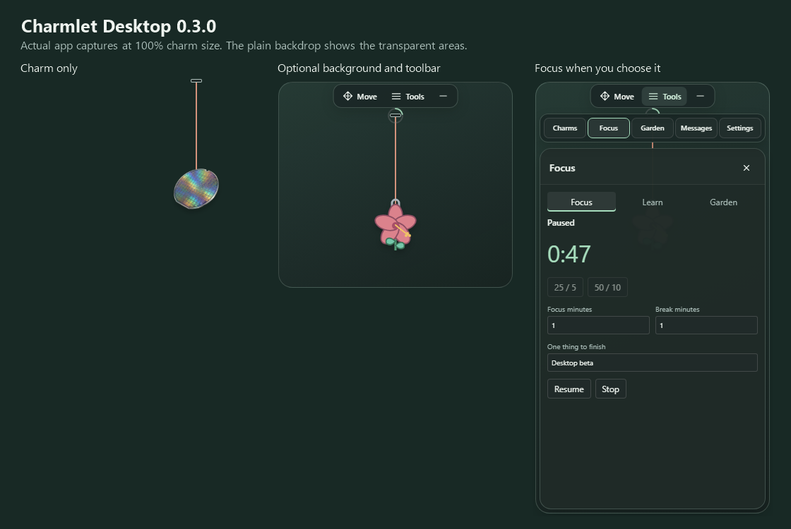

# Charmlet desktop developer beta

Charmlet Desktop is an unpublished Windows/macOS developer beta. It reuses the extension's charm renderer, physics, Focus/Learn/Garden controller, validated pack parser and confirmed JSON stores in one floating tray-managed window.

The **0.6.0 candidate** starts with just the charm and cord. Hover over the charm to reveal **Move**, **Tools** and hide-to-tray controls. **Tools** opens Charms, Focus, Garden, Messages or Settings on demand; closing the selected panel returns to the minimal view.

Drag **Move** to place the charm, or focus that button and use the arrow keys (Shift moves farther). Pulling the charm itself stretches the cord within the current display's available space, then releases into the shared bounce. The peg starts near the screen's top edge; compact controls no longer restrict the play area.

Under **Tools > Settings**, **Background**, **Keep toolbar visible** and **Keep messages visible** are separate saved preferences, all off by default. The tray's **Open Controls** and **Reset Window Position** remain available.

The trial shares the extension's 167 offline charms: 159 rendered designs, Terminal, four live companions and three fidget tools. **Charms > Live 3D** offers Cali, Sunny, Nimbus and Byte with prompt glances, blinks and reactions. **Stress Busters** brings the working spinner, bubble-pop charm and worry stone together with the existing smiley balls and squishies. Tap/flick, press a bubble or hold/rub the stone; Space/Enter also work. Giant Panda, seven new dog breeds including Goldendoodle and Husky, and two cats join Animals. The eighteen-flower garden, imports, photos, saved cords and pins remain intact. Final release artwork and pricing remain undecided.

Choose **Cali** for a California-inspired golden bear with brief encouragement bubbles. Click for a positive word, or use focus sessions for gentle prompts. **Tools > Focus > Cali's encouragement** saves your optional name and controls for bubbles and focus prompts. Escape dismisses a bubble; it never blocks clicks through the desktop. Confetti for new wins follows the Small wins celebration setting and Reduced Motion. Everything stays silent. Other charms keep their usual appearance.

**Appearance > Cord material** matches the charm or remembers your chosen cord. **Focus > Small wins** records achievements and completed live focus sessions, with undo and optional celebrations. **Photo charms** opens a local crop and frame editor: only the finished keepsake is stored, with no uploads. Sunny blinks, glances toward a nearby pointer and reacts to squeezing and wins; Reduced Motion stops idle animation. All these controls stay tucked away until selected.



## Local commands

**On the Windows PC (PowerShell), from the repository root:**

```powershell
npm.cmd --prefix desktop install
npm.cmd --prefix desktop run test
npm.cmd --prefix desktop run package
```

The Windows 0.6.0 packaging target is an unsigned folder under `desktop/release/0.6.0/Charmlet-win32-x64/`. Packaging uses the manifest version and a versioned output directory, refuses overwrites and leaves earlier releases intact. Current checks are recorded in the [Phase 9 verification log](../docs/phase-9-live-fidgets-hosting.md). Signing, notarization, update service, store listing and public distribution remain release work.

For a portable download, archive and test the extracted application.

**On the Windows PC (PowerShell), from the repository root:**

```powershell
node desktop/archive.mjs
```

This writes a Windows ZIP under `desktop/distribution/`. The hosted Mac job writes a `.tar.gz` so the `.app` keeps its executable permissions and framework links. Both archive types are extracted and launched in disposable profiles before upload. GitHub's outer artifact ZIP contains that tested archive; extract it, then extract the inner archive and keep the app folder together.

## Current candidate evidence

The [Phase 8 record](../docs/phase-8-personalization.md) tracks the new cord, win, photo and live-renderer checks. The following historical results do not establish this candidate's release status. Development geometry checks use a separate CDP touch pointer to avoid interference from a real desktop mouse; the isolated Windows workflow retains the unfiltered native mouse, movement and click-through checks.

## Historical local evidence - 2026-11-04

Version 0.3.0 changes the desktop presentation and placement. Type/build, twelve model checks and the development-host smoke pass, including long downward/sideways pulls, saved display preferences, migrated position, restart, focus and garden state. The production VS Code renderer remains byte-identical. Package/hosted results and open native interaction gates are recorded in [Phase 7](../docs/phase-7-desktop-minimal.md).

## Historical local evidence - 0.2.1

Version 0.2.1 adds smiley and emoji Stress Busters and a second Drishti variation to the complete catalogue and holiday defaults introduced in 0.2.0. Current-version package and archive checks are recorded in [Phase 6](../docs/phase-6-trial-catalogue.md); the earlier evidence below does not establish the new candidate's result.

## Historical local evidence - 0.1.2

Version 0.1.2 includes the shared release bounce and silhouette attachment, soft Stress Busters, the motivational deck and optional festive defaults. Manual choices and imports pin the selected charm. This build retains the original bundled artwork; new designs are separate review imports.

Type/build, six model tests and the developer smoke passed. `node desktop/archive.mjs` extracted the Windows ZIP and launched its executable in an owned profile; restart, focus, garden, sandbox/IPC configuration and saved state passed. Native click-through and the OS behavior checklist below remain manual gates.

`desktop/distribution/Charmlet-desktop-0.1.2-win32-x64.zip` is 158278080 bytes; SHA-256 `1b39b8a32f908010b33f6674e9bc69c00280c69fb69014036a60c0df47872b21`.

## Historical local evidence — 2026-10-09

Windows 0.1.1 includes the same Charms/Focus/Garden/Settings navigation, motivation-first fresh state, compact reminder controls and host-version footer as extension0.4.3. Build/type checking, six model checks and the owned dev smoke passed. The portable ZIP was extracted and the extracted executable passed restart, focus, garden, source security and saved-state checks in a disposable profile.

`desktop/distribution/Charmlet-desktop-0.1.1-win32-x64.zip` is 158274214 bytes; SHA-256 `c77c0105bc61d3d81b08eb66f420508132ccd202402b9fb8549b04ec91f9db52`. This is an unsigned local beta, not proof of the native/manual gates below or a current-version Mac run.

## Data and security boundaries

- Desktop data stays under the app's own Electron profile: `preferences.json`, `companion.json`, `packs/`, `anchor/preferences.json` and `desktop-view/preferences.json`. Earlier `window/preferences.json` placement is migrated without deleting that file.
- Desktop and IDE profiles do not automatically synchronize focus or garden progress.
- The renderer uses `contextIsolation: true`, `sandbox: true`, `nodeIntegration: false` and a narrow preload bridge.
- `charmlet:` serves only the copied template, bundles, styles and known media.
- Source links are opened only from reviewed learning-card IDs.
- No telemetry, account, global hotkey, autostart or update polling is present.

## What automated evidence proves

The owned Electron smoke test verifies profile isolation, renderer security flags, shared state/restart behavior, earned artwork, explicit-control focus, saved placement, long pulls and the restricted hit-test IPC configuration. The transparent canvas spans one monitor's work area while visible controls occupy a compact frame. CDP input and the diagnostic ignored-state do **not** prove that native clicks pass through to another application.

The Windows archive job also checks real OS input on its isolated desktop. It has passed native Move and saved placement, clicks reaching an owned window underneath, and a long pull/bounce/settle while that background window keeps focus. That evidence covers one Windows display at 100% scaling. Local test commands leave the system cursor alone.

## Manual gates before any wider beta

- Native behavior over the owner's active editor on Windows and macOS; Windows CI covers an owned background window.
- Ordinary charm play does not steal focus from the active editor; explicit controls do. Windows CI verifies this distinction between its owned windows.
- Tray/menu-bar Show/Hide, Focus/Learn/Garden, pack dialogs and Quit.
- Monitor disconnect/reconnect, negative-coordinate displays and mixed-DPI movement.
- OS suspend/lock and macOS Spaces behavior; running focus pauses and never auto-resumes.
- macOS package/run evidence from the hosted workflow.
- Owner decisions for source/art license, signing, notarization and distribution.
