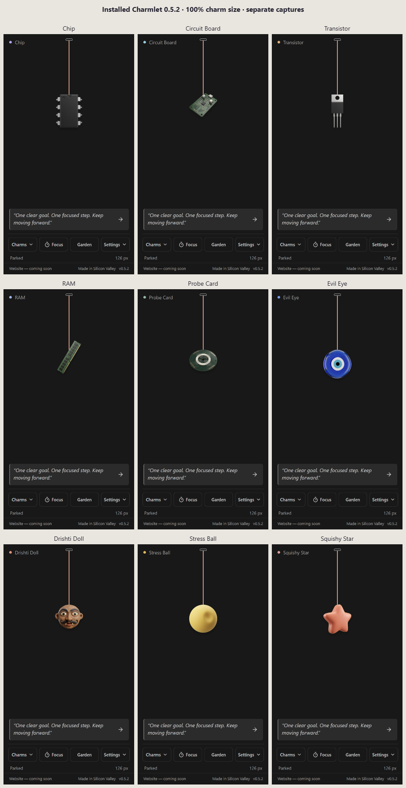

# Charmlet 0.5.2 artwork review

The replacement sample is ready to judge inside the actual installed app. These are separate captures at the default **100% charm size**, with normal motion enabled and each charm at rest. Every charm's layout measured 72x84 CSS pixels. Open the images at full size to inspect the original capture pixels.

## Nine-design replacement sample

Chip, Circuit Board, Transistor, RAM, Probe Card, Evil Eye, Drishti Doll, Stress Ball and Squishy Star:

## Other views

- [Original Terminal beside Chip and Stress Ball](../website/assets/app-review/terminal-chip-stress-at-100-percent.png)
- [Kovil, Cricket, Robot Assistant and five seasonal designs](../website/assets/app-review/heritage-sports-seasonal-at-100-percent.png)
- [Six designs on light backgrounds](../website/assets/app-review/light-background-at-100-percent.png)

The source review contains 64 selected designs: 51 importable candidates, twelve earned-flower previews and the original Terminal. Sixteen packs include the nine-design Refresh Sample, Bay Area Days, Stress Busters and Seasonal. Forty-one unclear concepts are omitted from the featured selection; previously shared downloads retain their identities.

## Try the review build

On the Windows PC, install the 0.5.2 VSIX from the reviewed build, then import **Refresh Sample** from the artwork-review page using **Charmlet: Import Charm Pack**. Open **Charms** to choose a design. Imported items are separate from the bundled originals.

Hold Stress Ball or Squishy Star with the pointer or Space/Enter to squeeze, then release. Reduced Motion removes the transition and bounce.

For seasonal selection, import **Seasonal**, open **Settings → Appearance**, enable **Use festive defaults** and unpin the current charm. The installed holiday artwork is chosen on the local holiday date. Picking a charm pins it across dates and reloads.

## Decisions still open

Give keep/change/drop feedback, especially on the revised Evil Eye and Drishti Doll. The final bundled, website and paid selection still needs approval. These images document a review build, not approved production artwork. Named athlete/league designs and the remaining heritage concepts are ideas, not released assets.

The captures used the real 0.5.2 VSIX: 131204 bytes, SHA-256 `bf5764257050b3219fcdab536e2a87ffcfe565a6ebee5b362719f6d461c09e3c`. The isolated profile left normal editor settings and saved progress untouched.
