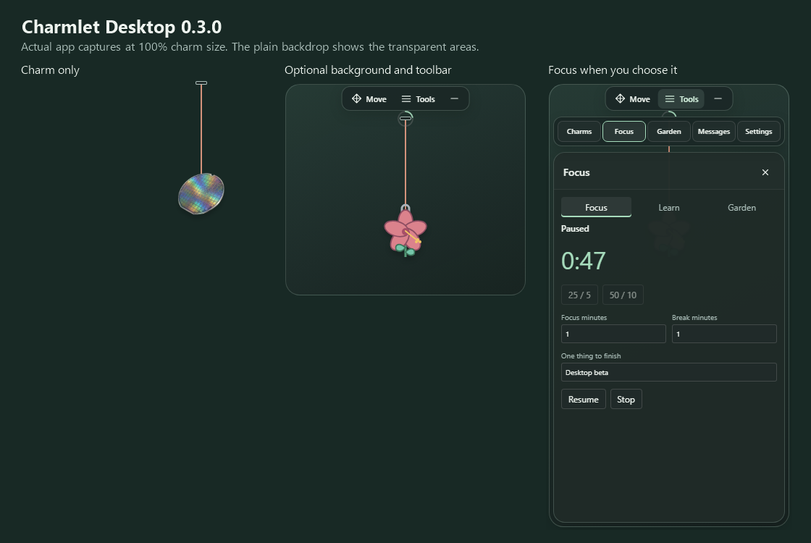

# Phase 7: minimal desktop trial

The owner asked for a charm-only desktop default, optional background and controls, reliable placement, and more room to pull the charm. This phase changes the standalone desktop app; the extension stays at 0.6.1.

## Desktop 0.3.0 behavior

- Just the charm and cord appear by default. Hover reveals Move, Tools and hide-to-tray.
- Tools opens Charms, Focus, Garden, Messages or Settings; only the chosen panel is shown.
- Background, Keep toolbar visible and Keep messages visible are independent saved choices.
- Move supports dragging and arrow keys; Shift uses larger steps. The tray can reopen controls or reset placement.
- The transparent play canvas covers the current monitor's work area. Compact controls clamp to that area independently of the peg. A new peg starts three pixels below the work area's top edge.
- Existing window placement migrates to a saved peg position. Charm choice, imports, focus, reminders and garden data remain in the desktop's own profile.

The first compact-window implementation also reduced the physics area to a 260-pixel stage. The owner caught the resulting short pull. The canvas and controls are now separate, with regression checks for long downward and sideways pulls.

These are actual app captures at the 100% charm setting, composited on a plain backdrop so the transparent areas are visible. They show Wafer and Hibiscus examples.

## Verification

| Check | Current result |
|---|---|
| Desktop type/build and model tests | Passed; 12 model tests |
| Development-host smoke | Passed, including 500-pixel downward/sideways pulls and return, keyboard placement, old-position migration, display preferences, panel closing, restart, focus, garden and security configuration |
| Extension type/lint | Passed |
| VS Code production renderer | Byte-identical to the baseline: 210787 bytes; SHA-256 `7059899de37297d4c1e03c9ebdf8a6a70c94ac62d6cda1855f37010876fee7de` |
| Extracted Windows 0.3.0 archive | Passed in Windows CI and on the owner's Windows PC; local archive smoke completed in 37.2 seconds |
| Hosted Windows/macOS desktop and six editor jobs | All eight passed at `b1daf31596eaa6dd2dba97e1aba7b4d3cc8d9a29`: [editor checks](https://github.com/gautham-nvidia/charmlet/actions/runs/41930913743), [desktop archives](https://github.com/gautham-nvidia/charmlet/actions/runs/41930913791) |
| Native Windows mouse/click-through | Passed on the isolated Windows runner at 100% scaling: Move, saved position, clicks reaching the owned background, long pull, bounce/settle and focus |
| Native macOS behavior, monitor changes and mixed DPI | Open manual gates |

The only shared renderer source change exports the existing resize function. The desktop entry point calls it after its peg moves, and its build supplies the desktop layout adapter. The extension continues to use its original layout and production renderer.

The Windows archive job enables real OS input only on its isolated GitHub Actions desktop. It measures native window bounds, keeps pointer actions inside an owned background window, and verifies Move, saved placement, clicks reaching the window underneath, and a long pull followed by bounce and settle without taking focus. It retains `desktop-native.json` alongside existing evidence. Local test commands do not move the system cursor.

The native test uses `SendInput` for both movement and buttons. Merely repositioning the cursor did not trigger the low-level hover forwarding; the background fixture also needed to be a normal window below the always-on-top charm. The passing run verifies the native window at the target before dragging. Earlier failed probes are not counted as successful evidence.

The local trial is `desktop/distribution/Charmlet-desktop-0.3.0-win32-x64.zip` (167,106,972 bytes), SHA-256 `dbac0b03bf3fb0be5858c6a3cc7dc280eccf41e2cd211f6f56907c2667a9a64e`. `node desktop/archive.mjs` extracted and launched that ZIP in an owned profile, verifying state restoration and the full-window gesture area. Its native Windows evidence comes from the separate CI build of the same application code; the local smoke does not move the system cursor.

## Optional productivity ideas

Keep the default quiet. The owner likes the charm alone and has not requested another automatic display feature.

| Idea | How it could stay minimal | Status |
|---|---|---|
| Next small step | One short note opened from Tools; optionally shown during focus | Proposal |
| Focus cue | An opt-in small timer or progress ring; the full timer stays in Focus | Proposal; existing focus timer remains available |
| Small-win celebration | A brief optional effect after a completed session or manually recorded win | Proposal |
| Motivational bubble | One short line beside the charm, then a fade; opt-in or explicitly requested | Brainstorm only; no automatic bubble added |
| Calendar-aware focus | Start with an explicit local calendar-file import and suggest a session that fits before the next meeting | Later proposal; no calendar access or import added |

The current Messages panel and optional persistent message card remain available. Calendar connections, task tracking and new celebration effects are outside this implementation.

## Release boundaries

This is an unsigned, unpublished trial. Native OS interaction, signing/notarization, source and artwork licences, distribution and the final bundled/free/paid artwork decisions retain their existing gates. Automated renderer input is separate from proof that native clicks reach another application.
