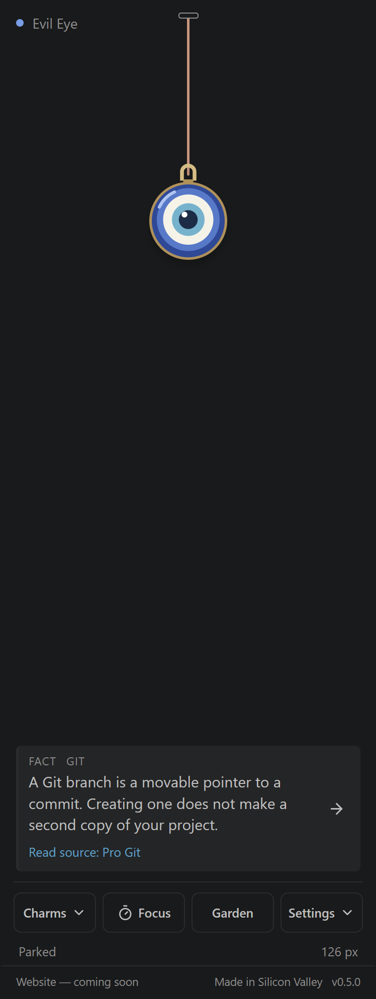
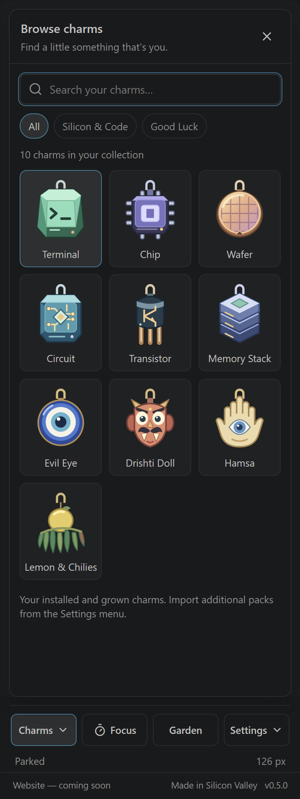
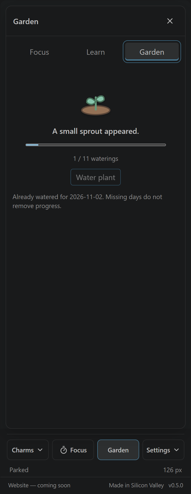

# Charmlet listing and launch copy

Prepared for the **0.5.0 review candidate**. This is copy and asset preparation, not an announcement that stores or paid services are live.

## Store fields

| Field | Prepared value |
|---|---|
| Name | Charmlet: Coding Charms |
| Short description | Free focus sessions, a daily garden, motivation and interactive charms for your coding day. |
| Price | Free |
| Categories | Other |
| Keywords | charms, focus, productivity, garden, motivation, silicon, accessibility |
| Support | https://github.com/gautham-nvidia/charmlet/issues |
| Project | https://github.com/gautham-nvidia/charmlet |
| Privacy | Packaged `PRIVACY.md`; repository copy at `extension/PRIVACY.md` |
| Publisher | `gautham-nvidia`, subject to actual registry ownership verification |

The authoritative long description is [extension/README.md](../extension/README.md), so the VSIX and store listing do not drift into different feature promises.

## Product introduction

**A little play in your coding day.**

Charmlet puts a small, interactive companion in your VS Code sidebar. Start a focus session, discover a coding fact, take a gentle water break, or grow a surprise flower one day at a time.

The extension and its core tools are free. Pick from ten starter charms, import extra artwork from the gallery, and keep every flower you earn. No account is needed for the extension, and installed charms and productivity tools work offline.

## Feature copy

- **Make your desk yours.** Search installed charms and switch collections in a visual picker. Pull a charm, release it and let it settle.
- **One thing at a time.** Choose a focus preset or your own duration, write an optional intention, and pause when you need to.
- **A small spark of curiosity.** Start with motivation, or switch to sourced coding, AI, GPU and testing facts and trivia.
- **Grow at your pace.** Plant a surprise seed and water once per local day. Your eleventh watering earns a permanent flower. Missing a day never removes progress.
- **Gentle reminders.** Optional water and movement cues offer Done, Snooze and Skip, with an option to wait for a focus break.
- **Free to import.** Download an ordinary Charmlet pack and bring it into the extension. Importing does not require a purchase or account.

## Screenshots and artwork

Use only captures of the actual reviewed version, in a disposable profile containing generated sample text. Show the version footer and original bundled artwork. Crop away unrelated editor panes and local filesystem paths rather than exposing a personal workspace.

The prepared app/picker captures are in `docs/store-assets/`. They show 0.5.0 in Windows VS Code 1.140, captured directly from the app element by the navigation scenario. No private workspace is included. The existing 256-pixel store icon is `extension/media/marketplace-icon.png`. A future promotional image may reuse these captures after the owner approves the final art lineup.

 

Do not describe the 95 redraw candidates as the released catalogue, show unapproved athlete/league art, claim NVIDIA sponsorship, or imply that the unsigned desktop beta and Photo Studio are available from the IDE listing.

## Phase 6 product-launch preparation

The branch `feat/phase-6-product-launch` is reserved at the merged Phase 4 baseline. Keep it idle until Phase 5 has finished; advance it to the accepted main commit before implementation. The store introduction, feature copy, app captures and website's current visual system form the reusable launch assets.

Before activating a broader launch:

1. Verify the published versions and official store URLs; then replace the website's null distribution links and extension footer placeholder with the real destination.
2. Select and license the final bundled/free artwork. Keep earned flowers in the app and confirm any premium collection and price separately.
3. Deploy the approved gallery, installation help, privacy and support pages. Check actual public downloads and mobile navigation.
4. Recheck installation from each live store and the declared supported editors. Report forks only after their real onboarding/runtime checks.
5. Complete native desktop input/monitor checks, signing/notarization and installer delivery before promoting the desktop app.
6. Complete merchant onboarding, purchase/refund/revocation checks and customer-facing terms before activating Photo Studio or paid packs.

## Announcement draft — use only after the links exist

**Meet Charmlet: a little play for your coding day.** Add an interactive charm to your VS Code sidebar, focus on one task, and grow a surprise flower at your own pace. The core extension, focus tools, garden and importer are free. Start with ten original charms, then explore the free gallery for more.

The final announcement needs verified installation/gallery links and the approved artwork selection before it can be posted. No announcement has been sent.
