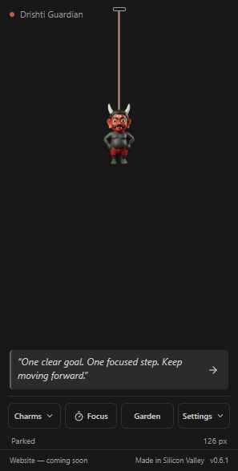
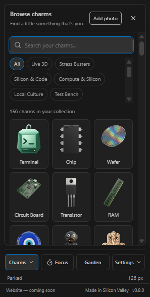

# Charmlet: Coding Charms

184 offline trial charms with matched cords, fifteen live companions, interactive fidgets and puzzles, local photo keepsakes, small wins, free Focus/Learn tools, a gentle garden and optional reminders.
The default Hanging layout saves headroom; Orbit layout reserves room for full loops.

**Playful charms trial, version 0.11.0.** Charmlet lives in a dockable VS Code view, not over your code
or desktop. It uses supported APIs and does not modify your VS Code installation.
It also works in Restricted Mode without asking you to trust workspace code.

 

## Try it

Install a development VSIX through **Extensions: Install from VSIX...**, or follow the
[source setup](https://github.com/gautham-nvidia/charmlet#readme).

Charmlet has its own Activity Bar container titled **Charmlet**. You can move it to the right sidebar using VS Code's view controls.

1. Open the Command Palette and run **Charmlet: Show Charm**.
2. For a right-side dock, run **View: Move View**, select **Charmlet**, then **New Secondary Side Bar Entry**.
3. Click any charm for a brief wiggle, or use Space/Enter. Cali adds a head tilt, wink, double take or victory shimmy. Pull downward and release for a rebound and smaller settling bounces; Reduced Motion returns directly to rest. Pull straight upward toward the peg to retract, then use the restore arrow to bring it back.
4. Click **Charms** to open the visual picker, search by name and filter installed collections. Choose **Settings → Appearance** for size, resting cord, visibility, motion and layout. The default 100% is 15% larger than earlier trials; adjust from 60% to 200% in 5% steps. Narrow views fit the charm to the available space.
5. Switch to **Orbit layout** for a full loop around the fixed peg; Hanging layout keeps a compact top peg and pull room.
6. Click **Focus** or run **Charmlet: Focus Session** for a focus/break timer with presets, custom minutes, pause/resume/stop and an optional intention.
7. Motivation is the fresh-state default, without a category heading. **Settings → Messages** offers Motivation, Facts + trivia, Facts or Trivia. Existing saved feed choices are preserved.
8. Click **Garden**, then **Plant a seed**, or run **Charmlet: Open Garden**. Water once per local day and earn an original flower after eleven valid waterings. Optional water/move schedules live under **Settings → Reminders**.
9. Run **Charmlet: Import Charm Pack** for a free downloaded `.charmlet.json`; remove imported packs with **Charmlet: Remove Charm Pack**.

The trial includes 175 rendered designs, Terminal, fifteen live companions and nine fidget/puzzle tools: **200 charms** in all. Open **Charms** to search the themed packs. Terminal is first, followed by Live 3D, Stress Busters and Music; no separate imports are needed.

**Music** has twelve instruments and controllers. **California** includes Palace of Fine Arts, Painted Ladies, Pebble Beach, Coastal Cypress, Salesforce Tower, Granite Dome and campus designs inspired by NVIDIA Santa Clara and Apple's original Infinite Loop. **Celebrations** adds Diwali Diyas and Halloween Lantern, with clearer Black Friday and Cyber Monday designs. Soldering Iron and Digital Caliper have retired from the built-in collection; their saved selections move to Terminal.

**Pets & Wildlife** includes Giant Panda, Golden Retriever, Labrador, German Shepherd, Husky, Corgi, Beagle and Goldendoodle, plus Silver Tabby and Tuxedo Cat.

Grow red, pink, white and yellow roses, jasmine and lily alongside the original twelve garden flowers. Each seed still blooms after eleven daily waterings. Existing plants and collected flowers are preserved, and seeds choose flowers you have not collected before returning to familiar varieties.

The nine early designs have retired from the picker. Saved choices, pins and cord materials move to the matching newer artwork. The garden now shows natural soil, terracotta and foliage; earned flowers use the current rendered artwork while keeping their saved IDs, dates and bloom counts.

**Charms > Live 3D** offers Cali the California grizzly, Sunny, Nimbus the cloud and Byte the robot, plus Coast Redwood, Yosemite, Lake Tahoe, Western Gull, Harbor Seal, Golden Gate, Santa Cruz Otter, Pacific Gray Whale, Pacific Dolphin, California Condor and Golden Eagle. Tap Nimbus for sunrise, rain and lightning, or hold for a small shower. Byte's taps show flowing binary, a compile check and a terminal prompt. They react promptly and rest between interactions. Reduced Motion keeps feedback still; software rendering preserves the detailed artwork when graphics support is unavailable.

Cali wears denim on Monday, a hoodie on Tuesday, a vest on Wednesday, flannel on Thursday, a relaxed coastal shirt on Friday, trail fleece on Saturday and a soft knit on Sunday. The local date chooses the outfit. His face stays consistent, with live glances, waves and thumbs-up celebrations. Painted colour figures remain available under Culture & Traditions, including seated Shiva and Nataraja.

**Cali** is an original California-inspired mascot. Click or press Enter for a short encouragement bubble; focus sessions add start, halfway and completion cues. Under **Focus > Cali's encouragement**, add an optional name, turn bubbles off or disable focus prompts. Escape dismisses a bubble. Text stays local and never takes keyboard focus. Enable celebrations under Small wins for confetti when you record a new win or complete a live focus session; everything stays silent, and Reduced Motion keeps celebrations still.

**Settings > Appearance > Cali's outfit** offers automatic daily outfits or a saved choice of any of his seven looks. Select Cali to see this control.

**Charms > Stress Busters** offers four spinners: the original three-lobed design, **Orbit**, **Pinwheel** and **Bar**. Drag a rotor to turn it, then release to coast. Pull the centre to stretch the cord. Space/Enter spin; Shift+Space reverses. **Bubble Pop** and **Worry Stone** remain alongside the smiley balls and squishies.

Choose **Twisty Cube**, **Sliding Tiles** or **Lights Out**, then click **Play** for the larger board. The cube has real quarter-turn moves on all six faces; tiles slide only into the neighbouring gap; light switches flip their neighbours. Shuffle, undo and reset are available, and progress saves locally. Tapping the hanging charm makes a small move. Everything stays silent, with no timers, scores or streaks.

**Settings > Appearance > Cord material** matches the selected charm or remembers your manual choice. Eight materials are available, including gold/silver chains, braid, soft cord and the original thread.

**Focus > Small wins** stores short achievements, with undo and clear-history controls. A focus session that finishes while the app is running earns one win; stopped, break and recovered overdue sessions do not. Daily counts follow the local date. Milestone celebrations are off by default and respect Reduced Motion.

Choose **Make a photo charm** in Charms or **Photo charms** in Settings. Crop a PNG, JPEG or WebP, preview its frame on light/dark backgrounds and at actual size, then save and hang it. Images are processed locally; only the finished small PNG and your chosen name are saved. Original files and metadata are not retained or uploaded. Remove keepsakes in the same panel.

Stress Busters include happy, determined, calm and winking smiley balls, plus a soft heart, thumbs-up and rocket. Hold the charm or hold Space/Enter while it is focused to squeeze, then release. The cord follows the visible outline and stays attached while the shape compresses. The full-body Drishti Doll is joined by a red-faced, horned Drishti Guardian; both remain available.

Flower illustrations do not unlock garden achievements or change watering progress. Existing imported packs keep their stored files and selected IDs. Exact copies of trial artwork share one picker entry; different older imports remain labelled **Imported**.

The ten original SVGs are preserved, including the original Terminal:

| Group | Preserved originals |
|---|---|
| Silicon & Code | Terminal, Chip, Wafer, Circuit, Transistor, Memory Stack |
| Good Luck | Evil Eye, Drishti Doll, Hamsa, Lemon & Chilies |

| Control | Action |
|---|---|
| Drag sideways and release | Swing with momentum |
| Drag around the peg | In Orbit layout, complete a loop; release returns to the selected resting length |
| Orbit layout | Toggle between compact Hanging and full-loop geometry |
| Settings → Hide charm / restore arrow | Hide or restore the last parked length with a full-size target |
| Appearance → Motion | Enable or disable animation |
| Charms | Open the searchable visual picker with installed-collection filters |
| Focus button / Focus Session command | Start, pause, resume or stop a persisted focus/break timer |
| Garden button / Open Garden command | Water once per local day and earn a selectable flower after eleven waterings |
| Settings → Reminders | Schedule a recurring in-app notice with Done, Snooze and Skip; no automatic drawer opening or focus change |
| Next coding message | Advance the saved motivation/learning feed and restart the five-minute countdown |
| Settings → Appearance or Messages | Change appearance or feed preferences; Escape closes the panel and returns focus |
| Import / Remove Charm Pack | Add or remove validated static-PNG data packs |
| Reset arrow | Restore default size/cord and reveal the selected charm; keep its selection and the motion preference |
| Status bar Charmlet item | Toggle or reveal the charm view |

With the charm keyboard-focused: Enter/Space nudges, Left/Right swings, Up/Down adjusts the cord,
and Escape hides. System reduced-motion preferences override the animation switch.

Charm choice, layout, size, resting cord, visibility, motion and message preferences use an extension-owned local preferences file. Existing saved settings are used as a migration fallback when that file is first created or unreadable.
The displayed cord may shorten temporarily to fit the current panel while the Cord setting keeps the
requested resting preference. Cancelling a drag keeps that preference. A downward pull stretches and
eases back on release; a straight upward pull retracts and the full-size arrow restores it.

The learning card sits below the stage and above the controls. It contains 60 sourced facts, 30 sourced
trivia questions and 80 motivational messages. Motivation is the fresh-state default; saved choices are not reset. Automatic rotation runs every five
minutes only while the card is available, settings/tools are closed, no request is pending and no card or
drag is active. Feed mode, card identity, trivia reveal state and rotation preferences persist.

Focus sessions use a separate local companion file and a host-owned deadline rather than renderer frames.
A running timer updates the display once per second without writing every tick. Pause preserves the exact
remaining duration across reload; expiration recovers one finished session without auto-starting another.

The free garden uses one garden-wide watering allowance per host-local day. Missed days pause progress,
a planted species cannot reroll on reload, and the eleventh valid watering adds its original flower to
**Grown by you** before the UI confirms it. A new seed does not reset that day's allowance. Water and move
reminders are off by default, bounded to 15–180 minutes, and show one quiet cue with Done/Snooze/Skip without stealing focus or stacking catch-up notices. Done and Skip schedule the next full interval; Snooze waits ten minutes. **Wait for a break** defers the cue during a running focus session.

The footer shows **Website — coming soon**, **Made in Silicon Valley** and the actual installed host version. The artwork-review gallery contains a smaller curated selection and free review packs; importing those adds separate items rather than replacing bundled art or saved progress. The original Terminal stays.

The Stress Ball and Squishy Star review charms squeeze when held with the pointer or Space/Enter. Their cord attachment stays fixed as the artwork compresses. Reduced Motion removes the transition and the release bounce.

**Settings → Appearance → Use festive defaults** is on for new profiles. It follows 21 US celebration dates and rotates Christmas designs through December. Existing opt-outs and pinned choices survive updates. **Follow holiday defaults** enables the feature and unpins in one click; **Pin this charm**, a manual selection or an import protects a favourite across dates and reloads. Dates use the local calendar, with specific occasions taking precedence over the Christmas rotation. The usual saved charm returns on other days. Automatic choices never overwrite it.

## Free and local

The complete trial collection and every functional control are free in this build. The final artwork
lineup and any optional paid downloads remain undecided; the app's core tools remain free. They work
offline without login, runtime AI, network APIs, telemetry, payments or audio. Optional imported packs
contain validated static PNG data and do not add executable code. [Artwork provenance](https://github.com/gautham-nvidia/charmlet/blob/main/extension/ARTWORK.md)
records asset origins, while the project source/art license remains pending and separate from price.

## Current limits

- The entire curated collection is included for trial; artwork approval and the final release lineup remain open. Photo Studio and the standalone desktop beta are separate from this VSIX.
- Current candidate validation and remaining release gates are recorded in the [Phase 6 verification log](https://github.com/gautham-nvidia/charmlet/blob/main/docs/phase-6-trial-catalogue.md). The matrix covers VS Code **1.90.0 and 1.140.0** on Windows, Linux and macOS, including an installed VSIX in Restricted Mode. Earlier results do not establish this candidate's status.
- The animation loop stops when settled or hidden. [Recorded measurements](https://github.com/gautham-nvidia/charmlet/blob/main/docs/phase-1-validation.md) include whole-editor overhead and do not promise zero CPU use.
- Intel Mac, Windows ARM, authenticated Cursor/Devin Desktop, browser hosts and Remote-SSH/WSL remain unverified.
- These checks cover the VS Code extension. The standalone developer beta has its own verification and manual desktop-interaction gates; see the repository's desktop guide.
- The dock occupies editor space. Hanging saves headroom; Orbit reserves room for a full loop. Small panels scale the play area.
- Charm choice, layout, size, resting cord, visibility, motion and message preferences persist locally; cross-machine sync is not implemented.
- This is not yet published to VS Code Marketplace or Open VSX. The manifest publisher is not
	evidence of a registered or verified Marketplace publisher.

## Project and feedback

[Privacy and local data](PRIVACY.md) describes saved preferences, focus notes, imported packs and data removal. Charmlet does not send workspace code or progress to a server.

[Report an issue](https://github.com/gautham-nvidia/charmlet/issues) with your OS/editor version,
steps to reproduce and expected behavior. Avoid including private code or credentials in screenshots.

[Project log](https://github.com/gautham-nvidia/charmlet/blob/main/PROJECT_LOG.md) records dated
decisions and validation; [CHANGELOG.md](CHANGELOG.md) records behavior changes.

Independent personal project; no NVIDIA sponsorship or endorsement. Charmlet's own source/art
license is not yet selected; a public repository is not automatically a reuse license. Bundled
dependencies retain their licenses in [THIRD_PARTY_NOTICES.md](THIRD_PARTY_NOTICES.md).
